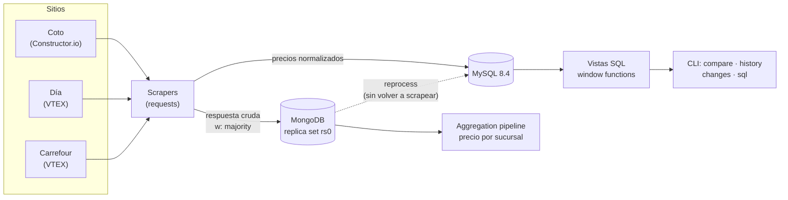
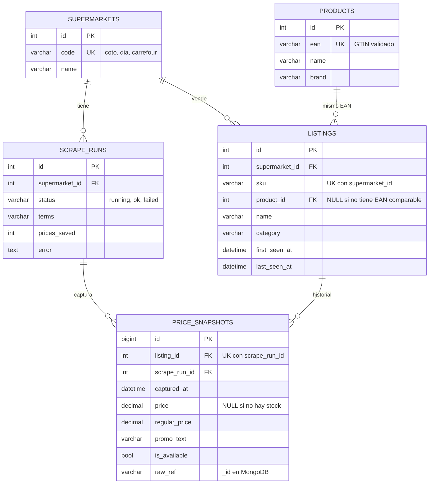

# ProyectoDB · Precios de supermercados argentinos

[](https://github.com/JuanMBF/ProyectoDB/actions/workflows/ci.yml)


Scraper de precios de **Coto**, **Día** y **Carrefour** que guarda el historial en **MySQL**, archiva cada
respuesta cruda de las APIs en un **replica set de MongoDB** y responde preguntas con **SQL**: qué súper
tiene más barato cada producto, cuánto cuesta la misma canasta en cada uno, qué precios cambiaron y
cuánto varía un precio entre sucursales.

```text
$ python -m preciosdb compare manteca
EAN            Producto                             Súper        Precio   Regular  Dif. vs. mejor     %
-------------  -----------------------------------  ---------  --------  --------  --------------  ----
7793940054006  Manteca Clasica LA SERENISIMA 200gr  coto       3.486,75  4.649,00            0,00   0,0
7793940054006  Manteca Clasica LA SERENISIMA 200gr  dia        3.750,00  5.010,00          263,25   7,6
7793940054006  Manteca Clasica LA SERENISIMA 200gr  carrefour  4.990,00  4.990,00        1.503,25  43,1
```

> Los ejemplos de este README salen de `python -m preciosdb demo`, que carga **datos de ejemplo**
> (ver [Datos de ejemplo](#datos-de-ejemplo)). Con `scrape` se consultan los sitios reales.

---

## Bases de datos que usa (las de mi CV)

| Tecnología | Para qué se usa acá |
|---|---|
| **MySQL 8.4** | Base principal: modelo relacional con claves foráneas, restricciones únicas, índices compuestos y precios en `DECIMAL(12,2)` (sin errores de redondeo). |
| **SQL** | Vistas con *window functions* (`ROW_NUMBER`, `RANK`, `LAG`, `FIRST_VALUE`/`LAST_VALUE`), CTEs y 5 consultas analíticas en [`sql/consultas`](sql/consultas). |
| **MongoDB 7 (replica set)** | Zona *raw*: cada respuesta de las APIs se guarda tal cual en un replica set de 3 nodos, con `writeConcern: majority`, índices y *aggregation pipelines*. Se prueba la caída del primario en CI. |
| **SQLAlchemy 2.0 + Alembic** | ORM tipado y migraciones versionadas (incluidas las vistas). El CI verifica con `alembic check` que las migraciones coincidan con los modelos. |
| **SQLite** | Para correr el proyecto sin Docker y para los tests rápidos. Las vistas y consultas están escritas en SQL que funciona igual en MySQL y en SQLite, y un test de integración verifica que **los dos motores devuelvan exactamente los mismos resultados**. |

H2 también figura en mi CV, pero es una base en memoria del mundo Java (la uso en los tests de
[HelpDesk Pro](https://github.com/JuanMBF/Portfolio/tree/HEAD/helpdesk-pro)); en este proyecto, que es
Python, ese papel lo cumple SQLite.

## Arquitectura



Cada página que devuelve un sitio sigue dos caminos:

1. **MongoDB guarda el JSON original**, sin tocar. Si mañana cambia el formato de una API o se corrige
   un parser, `reprocess` reconstruye los precios de cualquier corrida desde MongoDB, sin volver a
   consultar los sitios. También quedan ahí datos que no entran en el modelo relacional, como el precio
   de Coto en cada sucursal.
2. **MySQL guarda los datos normalizados**: el producto de cada súper (*listing*), el producto común a
   todos (identificado por código de barras) y un *snapshot* de precio por corrida. Los precios nunca se
   pisan: el historial completo queda consultable con SQL. Cada precio guarda el `_id` del documento de
   MongoDB del que salió (`raw_ref`).

### Modelo de datos



## Cómo se obtienen los precios

No hay APIs oficiales: se usan las mismas APIs públicas (sin login) que usan los sitios para su buscador.

| Súper | Plataforma | Endpoint | Datos que se toman |
|---|---|---|---|
| Coto | Constructor.io | `ac.cnstrc.com/search/{texto}?key=…&page=…` | `sku_plu`, `product_main_ean`, `product_list_price`, `discounts[]` y el precio por sucursal `price[]` |
| Día | VTEX | `diaonline.supermercadosdia.com.ar/api/catalog_system/pub/products/search?ft=…&_from=…&_to=…` | `items[].ean`, `sellers[].commertialOffer` (`Price`, `ListPrice`, `IsAvailable`) |
| Carrefour | VTEX | `www.carrefour.com.ar/api/catalog_system/pub/products/search?...` | ídem Día |

Reglas de normalización (todas con tests):

- **Promociones de Coto.** Un descuento directo (`25%Dto`) baja el precio de una unidad. Las promos que
  dependen de cuántas unidades se llevan (`2x1`, `70% 2da`, `3x2`) no cambian el precio unitario: se
  guardan como texto en `promo_text`.
- **Precio regular.** Se acepta un "precio de lista" solo si está entre el precio pagado y 3 veces ese
  valor; por encima es un error de formato de la fuente, no un descuento.
- **Sin stock.** Se guarda igual un snapshot con `price = NULL` y `is_available = false`, así un producto
  agotado sale de la comparación en vez de quedar mostrando un precio viejo.
- **Códigos de barras.** Para comparar entre cadenas se valida el dígito verificador GS1 y se descartan
  los prefijos de circulación restringida (`20`–`29`, `02`, `04`): son códigos internos de cada súper,
  como el queso o la carne que se venden por peso.
- **Scraping respetuoso.** Un request a la vez, con una pausa configurable (1 s por defecto) y reintentos
  con *backoff* ante errores 429/5xx.

## Vistas y consultas SQL

Las vistas se crean en una migración de Alembic
([`analytics_views`](migrations/versions/20261008_5b1e9c3a7d42_analytics_views.py)):

| Vista | Qué devuelve | Técnica |
|---|---|---|
| `v_latest_prices` | Última captura de cada producto en cada súper | `ROW_NUMBER() OVER (PARTITION BY …)` |
| `v_price_comparison` | El mismo producto en 2 o más súpers, rankeado por precio, con la diferencia contra el más barato | CTEs + `RANK()`, `MIN() OVER`, `COUNT() OVER` |
| `v_price_changes` | Cada cambio de precio entre dos capturas seguidas | `LAG()` |

Consultas listas para correr con `python -m preciosdb sql <nombre>`:

| Archivo | Pregunta que responde |
|---|---|
| [`01_canasta_comparable`](sql/consultas/01_canasta_comparable.sql) | ¿Cuánto cuesta en cada súper la canasta de productos que están en todos? |
| [`02_ranking_mas_barato`](sql/consultas/02_ranking_mas_barato.sql) | ¿En cuántos productos cada súper es el más barato y cuánto más caro es en promedio? |
| [`03_brecha_entre_cadenas`](sql/consultas/03_brecha_entre_cadenas.sql) | ¿Qué productos tienen más diferencia entre el súper más caro y el más barato? |
| [`04_promos_vigentes`](sql/consultas/04_promos_vigentes.sql) | ¿Qué descuentos directos hay hoy, del más grande al más chico? |
| [`05_variacion_por_supermercado`](sql/consultas/05_variacion_por_supermercado.sql) | ¿Cuánto variaron los precios en cada súper entre la primera y la última captura? |

```text
$ python -m preciosdb sql 01
supermarket  productos  total_canasta  total_sin_descuentos  productos_mas_baratos
-----------  ---------  -------------  --------------------  ---------------------
dia                  5      19.755,00             21.015,00                      3
coto                 5      20.140,75             21.303,00                      3
carrefour            5      21.644,00             21.644,00                      1
```

## Zona raw en MongoDB

Colección `raw_pages`, un documento por página de cada corrida:

```js
{
  run_id: 12,                 // corrida en MySQL
  supermarket: "coto",
  term: "leche",
  page: 1,
  url: "https://ac.cnstrc.com/search/leche?...",
  fetched_at: ISODate("2026-10-08T09:00:00Z"),
  products: 2,
  payload: { response: { results: [ ... ] } }   // JSON original de la API
}
```

- Índice único `(run_id, term, page)`: volver a guardar la misma página la reemplaza, no la duplica.
- Índice `(supermarket, fetched_at)` para las consultas por súper y fecha.
- Escrituras con `w: "majority"`: una página se confirma cuando la tiene la mayoría de los nodos, así una
  caída del primario no pierde datos ya confirmados.
- `branches` usa un *aggregation pipeline* (`$unwind` sobre los resultados y sobre `price[]`) para ver
  el precio de un producto en cada sucursal de Coto:

```text
$ python -m preciosdb branches 7790742363008
Sucursal    Precio  Producto
--------  --------  ------------------------------------------------------
061       2.750,00  Leche Larga Vida Entera Ua Clasica 3% LA SERENISIMA 1l
109       2.915,00  Leche Larga Vida Entera Ua Clasica 3% LA SERENISIMA 1l
...
5 sucursales · mín. 2.750,00 · máx. 3.035,00
```

El replica set (`docker-compose.yml`) tiene 3 nodos; `mongo1` tiene más prioridad, así que mientras está
sano es el primario. El CI mata `mongo1`, verifica que la aplicación siga escribiendo (otro nodo pasa a
primario) y lo vuelve a levantar.

## Cómo usarlo

### Con Docker: MySQL + MongoDB (recomendado)

```bash
git clone https://github.com/JuanMBF/ProyectoDB.git
cd ProyectoDB

docker compose up -d                       # MySQL 8.4 y el replica set de MongoDB
docker compose run --rm app migrate        # tablas y vistas
docker compose run --rm app demo           # datos de ejemplo (no necesita internet)
docker compose run --rm app compare leche
```

Para consultar los sitios reales:

```bash
docker compose run --rm app scrape --term leche --term yerba
docker compose run --rm app scrape --super coto dia --ean 7790742363008 --max 50
```

### Sin Docker (SQLite)

```bash
python -m venv .venv
source .venv/bin/activate          # En Windows: .venv\Scripts\activate
pip install -r requirements.txt

python -m preciosdb migrate        # crea data/precios.db
python -m preciosdb demo
python -m preciosdb compare leche
```

La configuración se toma de variables de entorno o de un archivo `.env` (ver [`.env.example`](.env.example)).
Sin `MONGO_URL` todo funciona igual, salvo los comandos que leen la zona raw.

### Comandos

| Comando | Qué hace |
|---|---|
| `migrate` | Crea o actualiza las tablas y las vistas (Alembic). |
| `scrape --term TEXTO --ean CODIGO [--super coto dia carrefour] [--max N]` | Busca en los sitios y guarda los precios. |
| `demo` | Carga datos de ejemplo: dos capturas con un día de diferencia. |
| `compare [TEXTO] [--ean CODIGO]` | Compara el mismo producto entre súpers. |
| `history CODIGO` | Historial de precios de un código de barras. |
| `changes [--days N]` | Cambios de precio recientes, de mayor a menor. |
| `sql NOMBRE` | Corre una consulta de `sql/consultas`. |
| `runs` | Últimas corridas, con su estado y error si falló. |
| `reprocess ID` | Reconstruye los precios de una corrida desde MongoDB. |
| `branches CODIGO` | Precio en cada sucursal de Coto (MongoDB). |
| `raw-stats` | Resumen de la zona raw por súper (MongoDB). |

## Tests y CI

- **108 tests unitarios** (pytest, ~98 % de cobertura) sobre SQLite y `mongomock`: parsers de cada API,
  reglas de precios y códigos de barras, pipeline, vistas, consultas SQL, migraciones y CLI.
- **7 tests de integración** contra MySQL 8.4 y el replica set real (`docker compose run --rm --build test`):
  carga los mismos datos en MySQL y en SQLite y verifica que todas las vistas y consultas den lo mismo,
  que los precios sean `DECIMAL` exactos, que las restricciones únicas se cumplan, que cada precio apunte
  a su documento en MongoDB y que `reprocess` reconstruya lo mismo.
- **GitHub Actions**: lint (`ruff`), `alembic check` y tests en Python 3.11, 3.12 y 3.13; después levanta
  todo con Docker Compose, corre la integración, usa la CLI de punta a punta y prueba la caída del
  primario de MongoDB.

```bash
pip install -r requirements-dev.txt
ruff check . && ruff format --check .
pytest --cov                              # unitarios
docker compose run --rm --build test      # integración (con `docker compose up -d` levantado)
```

## Datos de ejemplo

[`preciosdb/samples`](preciosdb/samples) tiene un catálogo por súper y por día con **la misma estructura
que las respuestas reales** de Constructor.io y de VTEX (campos, anidamiento y tipos). Los códigos de
barras son de productos reales; los precios de la leche La Serenísima en los tres súpers y de la manteca en
Día coinciden con capturas públicas de octubre de 2026. El resto de los precios, los precios por sucursal
y varios SKU son ilustrativos. Sirven para `demo` y para los tests, así todo el proyecto se puede probar
sin conexión.

## Límites conocidos

- Las APIs no son oficiales: los sitios pueden cambiarlas sin aviso. Por eso existe la zona raw y el
  comando `reprocess`, y por eso cada corrida registra su error si algo falla.
- La comparación entre súpers es por código de barras: los productos sin EAN o con códigos internos
  (por ejemplo, fiambres o carne por peso) se guardan, pero no se comparan.
- La URL de producto de Coto se arma con `COTO_PRODUCT_BASE_URL` + la ruta que devuelve la API; si Coto
  cambia la estructura de sus URLs alcanza con cambiar esa variable.
- Usá el scraper con moderación y revisá los términos de uso de cada sitio.

## Estructura

```
.
├── preciosdb/
│   ├── scrapers/        # base (normalización, EAN), coto.py (Constructor.io), vtex.py (Día, Carrefour)
│   ├── db/              # modelos SQLAlchemy, tipos (DECIMAL, UTC), repositorio de escritura
│   ├── samples/         # catálogos de ejemplo + cliente HTTP offline
│   ├── pipeline.py      # scrape → MongoDB → MySQL, y reprocess
│   ├── raw_store.py     # zona raw en MongoDB (índices, aggregation pipelines)
│   ├── reports.py       # consultas sobre las vistas
│   └── cli.py           # python -m preciosdb ...
├── migrations/          # Alembic: esquema inicial + vistas analíticas
├── sql/consultas/       # consultas analíticas (MySQL y SQLite)
├── docker/              # init del replica set y de la base de tests
├── tests/               # unitarios + integration/ (MySQL y MongoDB reales)
├── Dockerfile
└── docker-compose.yml
```

## Autor

**Juan Barros**: estudiante de la Tecnicatura en Desarrollo de Software (UADE), con experiencia en soporte
técnico y mesa de ayuda.

- GitHub: [@JuanMBF](https://github.com/JuanMBF)
- Más proyectos: [Portfolio](https://github.com/JuanMBF/Portfolio) (HelpDesk Pro en Java + React, Mongo
  Replica Lab e IT Support Toolkit) y [HelpDesk Pro en Python](https://github.com/JuanMBF/python)
  (FastAPI + Streamlit).

Proyecto bajo licencia [MIT](LICENSE).
